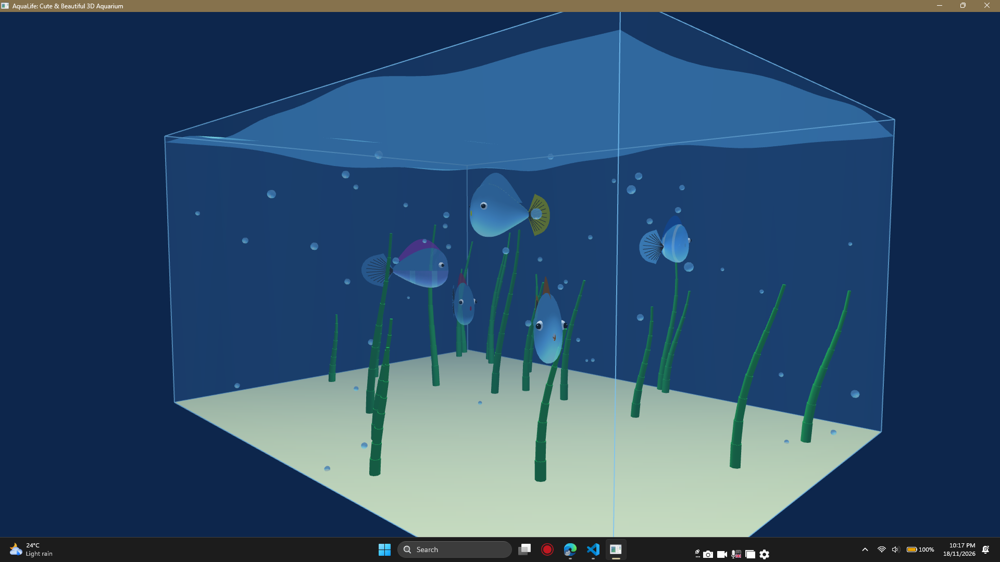

# 🐠 AquaLife: An Interactive 3D Aquarium Animation Using OpenGL

**AquaLife** is an interactive 3D aquarium application developed using **C++, OpenGL, and FreeGLUT**. It creates an underwater environment where five colorful 3D fish swim inside a transparent glass aquarium, surrounded by animated water waves, rising bubbles, swaying aquatic plants, rocks, and underwater fog.

The entire aquarium scene is generated programmatically using OpenGL. No external image, texture, or 3D model files are required for the core scene.

This project is developed as part of the **Computer Graphics Lab (CSE-4742)** at the International Islamic University Chittagong (IIUC), Spring 2026.

---

## 📸 Screenshots

### Water Surface and Wave Animation




---

## ✨ Implemented Features

### 🐟 3D Fish Modeling and Animation
- Five 3D fish with different colors.
- Parametric fish body modeling.
- Eyes, white body stripes, dorsal fins, pectoral fins, and animated tails.
- Natural swimming movement with tail and fin animation.
- Random wandering and direction changes near aquarium boundaries.

### 🌊 Animated Water Surface
- Water surface generated using two overlapping sine waves.
- Dynamic wave movement over time.
- Per-vertex normals for lighting and surface highlights.

### 🫧 Bubbles
- 50 animated bubbles.
- Continuous upward movement.
- Side-to-side wobbling motion.
- Bubbles restart when they reach the water surface.

### 🌿 Aquatic Plants
- 20 animated underwater plants.
- Plants modeled using chains of cylinders.
- Natural swaying animation.

### 🪨 Aquarium Environment
- 3D glass aquarium tank.
- Transparent glass walls with edge outlines.
- Sandy aquarium floor.
- Rocks and underwater decorations.
- Blue underwater background with exponential fog.
- OpenGL lighting and blending effects.

### 🎮 Camera and Interaction
- Camera rotation around the aquarium.
- Zoom in and zoom out.
- Camera reset.
- Pause and resume animation.
- Keyboard and mouse-based interaction.

---

## 🛠️ Technologies Used

| Technology | Purpose |
|---|---|
| C++ | Application logic and object modeling |
| OpenGL | 3D rendering, lighting, fog, and blending |
| FreeGLUT | Window management, keyboard input, and animation callbacks |
| MinGW-w64 | C++ compilation on Windows |
| VS Code | Development environment |
| Git and GitHub | Version control and project management |

---

## 💻 Requirements

- Windows or Linux
- C++ compiler supporting C++11 or later (MinGW-w64 g++ recommended for Windows)
- OpenGL development libraries
- FreeGLUT development libraries
- Graphics driver with OpenGL support

---

## ⚙️ Build and Run

### Windows (MinGW-w64)

**1.** Install MinGW-w64 and FreeGLUT.

**2.** Open the project folder in Command Prompt or VS Code terminal.

**3.** Compile all source files:

```cmd
g++ -std=c++17 -Iinclude src/main.cpp src/common.cpp src/fish.cpp src/environment.cpp src/water.cpp -o AquaLife.exe -lfreeglut -lopengl32 -lglu32
```

**4.** Run the application:

```cmd
AquaLife.exe
```

If Windows reports that `freeglut.dll` is missing, copy `freeglut.dll` from the FreeGLUT `bin` folder into the same directory as `AquaLife.exe`, or make sure its directory is included in your system PATH.

### Linux (Ubuntu or Debian)

Install the required development libraries:

```bash
sudo apt update
sudo apt install build-essential freeglut3-dev
```

Compile the project:

```bash
g++ -std=c++17 -Iinclude src/main.cpp src/common.cpp src/fish.cpp src/environment.cpp src/water.cpp -o AquaLife -lglut -lGL -lGLU
```

Run the application:

```bash
./AquaLife
```

---

## 🎮 Controls

| Key | Action |
|---|---|
| Up Arrow | Tilt camera upward |
| Down Arrow | Tilt camera downward |
| Left Arrow | Rotate camera left |
| Right Arrow | Rotate camera right |
| `+` or `=` | Zoom in |
| `-` or `_` | Zoom out |
| `Space` | Pause or resume animation |
| `R` | Reset camera |
| `Esc` | Exit the application |

---

## 📁 Project Structure

The project is organized into separate header and source files to make the code easier to maintain, understand, and extend.

```text
AquaLife-OpenGL/
│
├── include/
│   ├── common.h
│   ├── environment.h
│   ├── fish.h
│   └── water.h
│
├── src/
│   ├── main.cpp
│   ├── common.cpp
│   ├── environment.cpp
│   ├── fish.cpp
│   └── water.cpp
│
├── Screenshots/
│   ├── 1.png
│   └── 2.png
│
├── .gitignore
└── README.md
```

### Module Description

| File | Responsibility |
|---|---|
| `common.h / common.cpp` | Shared structures, constants, and mathematical utilities |
| `fish.h / fish.cpp` | Fish modeling, movement, and animation |
| `environment.h / environment.cpp` | Aquarium environment, bubbles, plants, rocks, and sand |
| `water.h / water.cpp` | Water surface and wave animation |
| `main.cpp` | Application entry point and initialization |

---

## 🚧 Planned Work

The following features are planned for future development:

- Underwater light rays and floating particles.
- Day and night lighting modes.
- Placing the aquarium in a realistic room or roadside environment.
- Sound effects with sound on/off controls.
- Interactive fish selection and fish information display.
- Additional aquarium interactions and visual improvements.
- Further testing, optimization, and deployment.

---

## 📚 Computer Graphics Concepts

This project demonstrates several fundamental computer graphics concepts:

- 3D object modeling using geometric primitives.
- Parametric modeling using mathematical functions.
- Transformations and camera manipulation.
- Lighting, shading, transparency, and blending.
- Fog and depth effects.
- Time-based animation.
- Sine-wave-based surface deformation.
- Interactive graphics using keyboard and mouse input.

---

## 👩‍🎓 Student Information

| Field | Details |
|---|---|
| Name | Rehab Binte Alamgir |
| Student ID | C233455 |
| Course | CSE-4742 – Computer Graphics Lab |
| Semester | 7th, Spring 2026 |
| Instructor | Sultana Tasnim Jahan |
| Institution | International Islamic University Chittagong (IIUC) |

---

## 📌 Project Status

**Ongoing – Under Development**

AquaLife is being developed in stages. The core aquarium environment, fish animation, bubbles, aquatic plants, rocks, camera controls, and animated water surface have been implemented. Additional interactive and visual features are planned for future development.

---

## 👏 Acknowledgement

Developed as an academic project for the Computer Graphics Lab (CSE-4742) at the International Islamic University Chittagong.

**Repository:** [AquaLife-OpenGL](https://github.com/Rehu33/AquaLife-OpenGL/)
