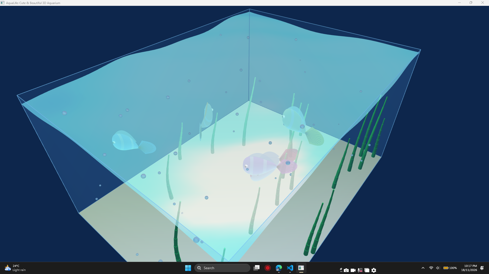

# 🐠 AquaLife: An Interactive 3D Aquarium Animation Using OpenGL

<p align="center">
  <strong>Explore an Animated Underwater World with C++, OpenGL & FreeGLUT</strong>
</p>

<p align="center">
  A Computer Graphics Lab Project
</p>

## 📖 About the Project

AquaLife is an interactive 3D aquarium animation developed using C++, OpenGL, and FreeGLUT. The project creates a virtual underwater environment with animated fish, rising bubbles, swaying aquatic plants, an animated water surface, underwater lighting, and interactive camera controls.

The main goal of this project is to demonstrate fundamental computer graphics concepts through an engaging and visually appealing 3D aquarium simulation.

## 🎯 Project Objectives

- Create a 3D aquarium environment with transparent glass walls and a sandy floor.
- Design and animate multiple 3D fish with color variation.
- Implement water waves, ripple effects, bubbles, and swaying plants.
- Apply lighting, fog, and blending for depth and atmosphere.
- Provide keyboard controls for camera, animation, and reset.

## ✨ Features

### 🐟 3D Aquarium Environment

- 3D aquarium tank with transparent glass walls.
- Sandy aquarium floor.
- Underwater blue background.
- Lighting, fog, and specular effects.

### 🌊 Water Effects

- Animated water surface using two overlapping sine waves for improved ripples.
- Transparent water surface with per-vertex normals for specular highlights.
- Underwater fog and depth effects.

### 🐠 Fish Modeling and Animation

- Multiple colorful 3D fish.
- Parametric fish body modeling.
- Fish eyes, dorsal fins, pectoral fins, and tails.
- White body stripes.
- Swimming animation with tail and fin movement.
- Automatic direction changes near tank boundaries.

### 🫧 Underwater Elements

- 50 rising animated bubbles with side-to-side movement.
- 20 swaying aquatic plants.

### 🎮 Interactive Controls

- Camera rotation, zoom in/out, and reset.
- Pause and resume animation.
- Exit functionality.

## 📸 Project Screenshots

### Water Surface Ripple




## 🛠️ Technologies Used

| Technology | Purpose |
|---|---|
| C++ | Core programming language |
| OpenGL | 3D graphics rendering |
| FreeGLUT | Window management and input handling |
| MinGW / GCC | C++ compilation |
| Visual Studio Code | Development environment |

## 🎮 Controls

| Key | Action |
|---|---|
| ↑ / ↓ | Rotate camera vertically |
| ← / → | Rotate camera horizontally |
| + / = | Zoom in |
| - / _ | Zoom out |
| R | Reset camera |
| Space | Pause / Resume animation |
| Esc | Exit the application |

## ⚙️ Installation and Setup

### Prerequisites

- Windows operating system
- Visual Studio Code
- MinGW / GCC compiler
- OpenGL libraries
- FreeGLUT library

### Steps to Run

1. Clone the repository:

```bash
git clone https://github.com/Rehu33/AquaLife-OpenGL.git
```

2. Open the project folder in Visual Studio Code.

3. Compile the source file:

```bash
g++ main.cpp -o AquaLife -lfreeglut -lopengl32 -lglu32
```

4. Run the generated executable:

```cmd
AquaLife.exe
```

If Windows reports that `freeglut.dll` is missing, copy `freeglut.dll` from your FreeGLUT `bin` folder into the same folder as `AquaLife.exe`.

## 🚀 Planned Features and Improvements

- Rocks and underwater decorations.
- Underwater light rays and floating particles.
- Day and night lighting modes.
- Aquarium placement in a room or roadside environment.
- Improved fish movement and collision handling.
- Final integration, testing, and optimization.

## 📚 Computer Graphics Concepts

- 3D object modeling.
- Geometric transformations.
- Animation and motion.
- Lighting and shading.
- Transparency and blending.
- Camera control and projection.

## 📂 Repository Structure

```text
AquaLife-OpenGL/
│
├── main.cpp
├── README.md
├── Screenshots/
│   ├── 1.png
│   └── 2.png
└── .gitignore
```

## 👩‍💻 Student Information

| Information | Details |
|---|---|
| Student Name | Rehab Binte Alamgir |
| Student ID | C233455 |
| Course Code | CSE-4742 |
| Course Title | Computer Graphics Lab |
| Semester | 7th Semester |
| Session | Spring 2026 |
| Instructor | Sultana Tasnim Jahan |
| Institution | International Islamic University Chittagong (IIUC) |

## 📌 Project Status

**Ongoing Development**

The project is being developed and improved incrementally. New visual effects and interactive features are added throughout the development process.

## 🔗 GitHub Repository

[AquaLife – An Interactive 3D Aquarium Animation Using OpenGL](https://github.com/Rehu33/AquaLife-OpenGL/)

<p align="center">
  <strong>🐠 AquaLife — Bringing the Underwater World to Life! 🌊</strong>
</p>